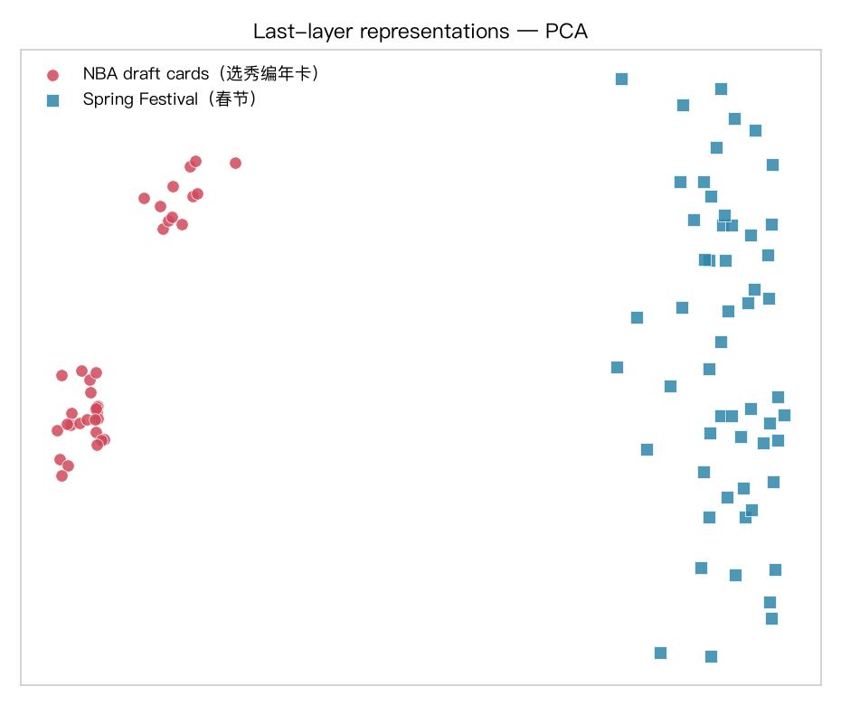
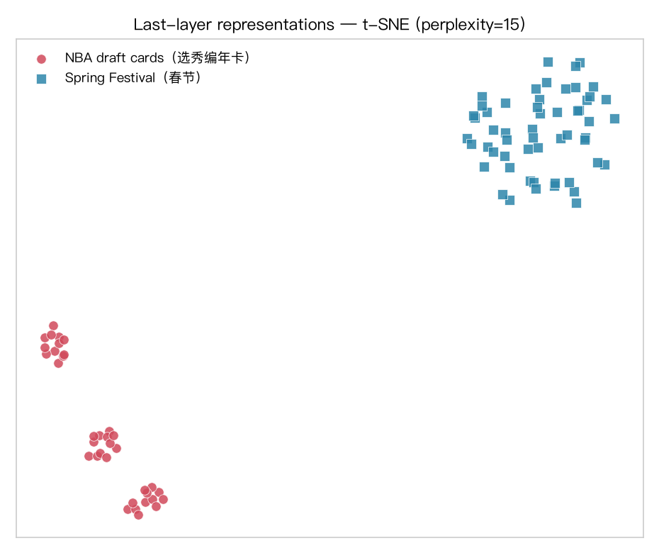
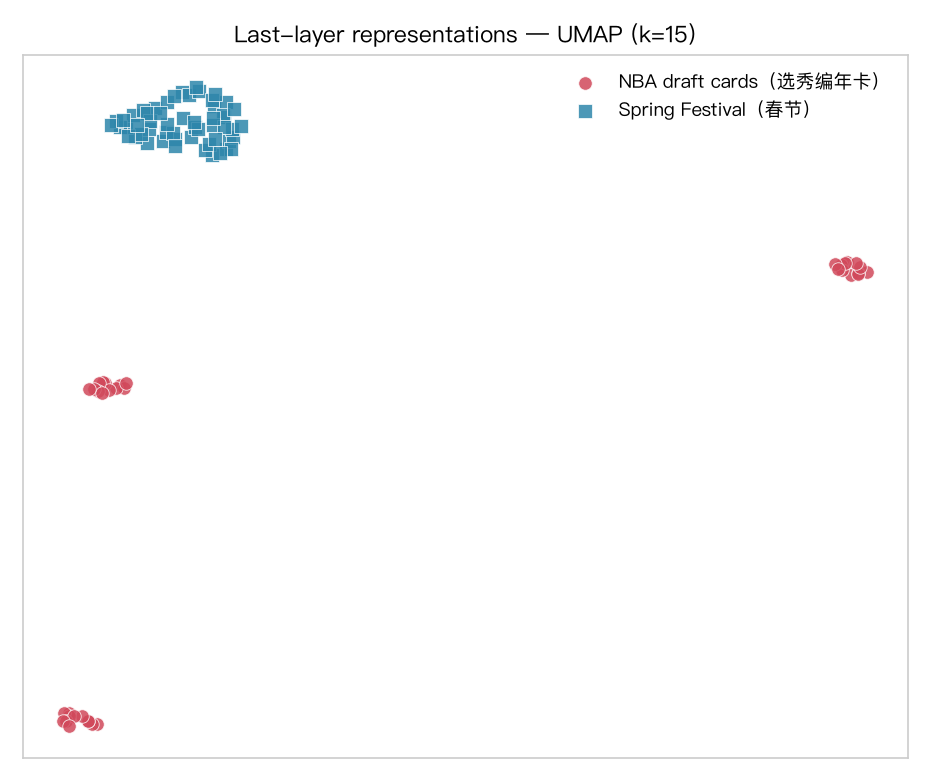
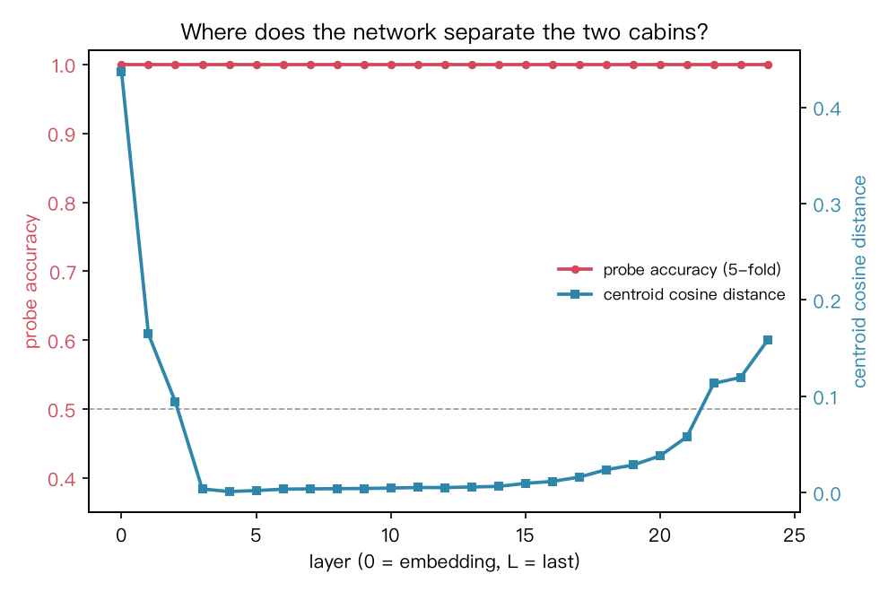
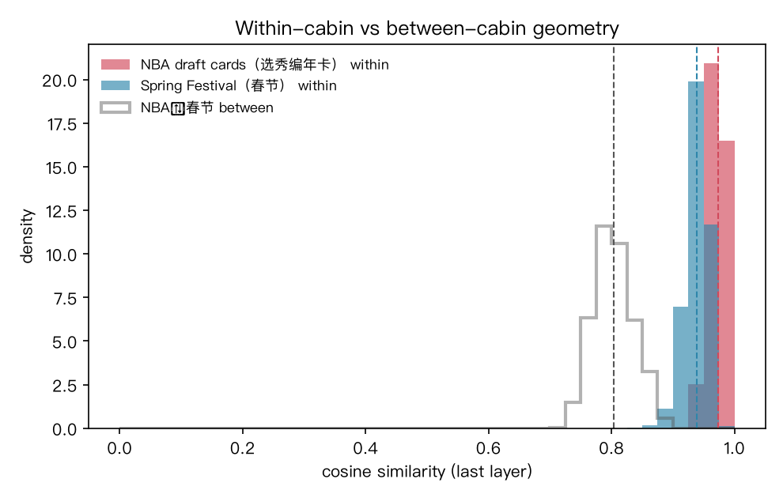
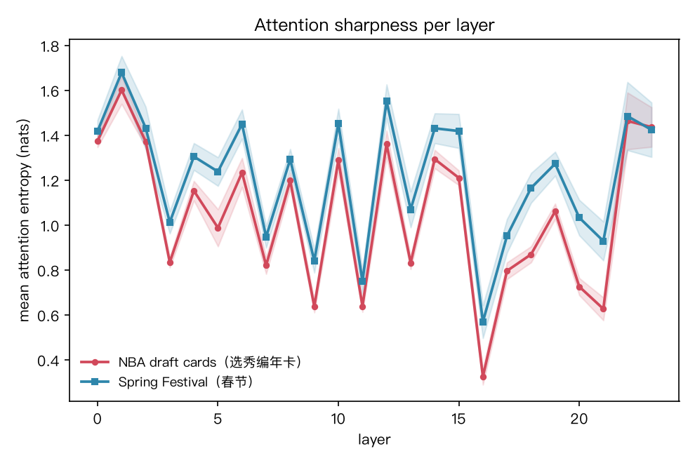

```{=html}
<!-- 本报告由 nba_vs_spring.py 生成; 图与读数均冻结于 2026-10-13 这次运行 -->
```

# 背景与问题

园中 P-B19《最小必要维度》案封存了四舱语料（`chora/experiments/pb19-mrd/pack.b64`）：
**D1_nba**（NBA 选秀编年卡）、D2_gen（通用）、D3_alpha（字母序）、**D4_spring**（春节舱）。
本报告取其中两舱——NBA 与春节——问一个视觉化的问题：

> 同一个 transformer，把两舱语料读进表征空间之后，**结构差异**长什么样？

两舱的先验结构画像（出自 `corpus/dag06/DESIGN_dag.md` 的主人裁定）：

- **NBA 舱**：选秀编年，「内容 × 顺序」二维结构——每张卡都是「年份 + 顺位 + 球员 + 球队」的同一模板，差异只在槽位取值。
- **春节舱**：习俗—吉祥话语义网——年货、守岁、春联、压岁钱、团圆……多主题松散联结。

# 方法

| 件 | 值 |
|---|---|
| 模型 | Qwen2.5-0.5B-Instruct（`first-lora/model`，本地盘，bf16，24 层 / 896 隐维 / 14 头） |
| 设备 | MPS（Apple Silicon） |
| 语料 | D1_nba 36 条（均 31.3 字 / 26.9 token）；D4_spring 55 条（均 35.5 字 / 29.2 token） |
| 抽取 | 逐条前向，`output_hidden_states=True` + `output_attentions=True`（eager）；每层 mean-pool 得 (25, 896) 表征 |
| 四把尺 | ① 末层投影（PCA / t-SNE）② 逐层线性探针（5 折 CV）③ 逐层质心距离与舱内/跨舱相似度比 ④ 逐层注意力熵 |
| 旋钮 | seed=13 · t-SNE perplexity=15 · UMAP k=15 |

正本：`benches/transformer_vis/nba_vs_spring.py`（源of truth）；派生：`figs/*.png`、`metrics.json`、本报告。
复现（verify）：`/opt/miniconda3/envs/default/bin/python nba_vs_spring.py` —— 退出码 0 且 `metrics.json` 重生成即通过。

# 读数

## 投影：末层表征的二维显影







两舱在末层表征空间中**各成一簇、不相混**：NBA 簇（红圆）紧而小，春节簇（蓝方）松而散。三种投影（PCA / t-SNE / UMAP）互为印证。

## 逐层探针：哪里开始分得开？



**探针准确率 = 1.000，从第 0 层（嵌入层）到末层逐层全对。**
⚠️ 诚实标注（见下「诚实账」）：这读的是**域分离**（两舱词汇本就不同：选秀/顺位 vs 饺子/红包），不是结构差异的证据。
质心距离则走出一个 V 形：嵌入层 0.437 → 中层压至 ≈0.005 → 末层回升 0.158——两域在深层共享邻域后，于输出前再度分道。

## 几何：簇的「形状」才是结构



| 相似度（末层 cosine） | 读数 |
|---|---|
| NBA 舱内均值 | **0.973**（极紧） |
| 春节舱内均值 | 0.939（较松） |
| 跨舱均值 | 0.804 |

舱内/跨舱相似度之比**逐层恒 > 1**（嵌入层 1.69 → 末层 1.18，最小 1.001）：
两舱的差异不在「位置」（深层质心几乎重合），而在**散布形状**——
NBA 是一条编年模板撑起的**紧链**，春节是一张多主题语义**网**。这正是 dag06 判词「顺序是最贫的一维」的 transformer 侧显影：编年结构被压成一个低散布簇。

## 注意力：模板文本 vs 多主题文本



NBA 舱平均注意力熵 **1.048 nats**，春节舱 **1.213 nats**——NBA 的注意力**更尖**（低熵），
与「模板文本只需盯住少数槽位（顺位/球员/球队）」吻合；春节答案更长、主题更多，注意力散布更开。
逐层看，春节熵几乎层高于 NBA（24 层中 23 层如此），差异稳定而非偶然。

# 判词

1. **域分离是平凡的**：嵌入层即线性可分，探针 100% 不携带结构信息——此尺在本实验中只配当 sanity check。
2. **结构差异在形状**：NBA = 紧簇（模板编年），春节 = 松散语义网；舱内/跨舱比逐层 >1 是主证据。
3. **注意力尖度**佐证：模板文本注意力低熵集中，多主题文本高熵散布。
4. 一句话：**transformer 把「编年」读成紧链，把「习俗」读成网**——两舱的结构差异，可视化成立。

# 诚实账

- 语料小（36 / 55 条）、单模型（0.5B）、单 seed（13）、MPS bf16——读数是指示性的，非裁决性的。
- 探针 100% 可分源于词汇域差异，**不可**作为「结构被捕捉」的证据；结构证据是 §形状与§注意力两节。
- UMAP 与 PCA、t-SNE 三投影并列，结论不依赖单一投影的选择。
- 本模型盘为春节舱 LoRA 案所用同款（first-lora/model），对春节舱或有轻微偏向——跨舱比较的公平性待「基座 vs 微调」消融后定谳。

# 候弹（next shots）

- **打乱对照**（dag06 C42 非交换律）：把 NBA 卡的顺位数字打乱再编码，看紧簇是否撕裂——那才是「顺序即结构」的直接检验。
- **槽位注意力**：抽出每层对「第X顺位」数字 token 的注意力权重，可视化编年结构的逐层追踪路径。
- **升级**：换更大模型（Qwen2.5-7B）与多 seed，复跑全流程。

# 复现

```bash
cd benches/transformer_vis
/opt/miniconda3/envs/default/bin/python nba_vs_spring.py   # → figs/ + metrics.json
quarto render report.qmd --to html                          # → 本报告
```
