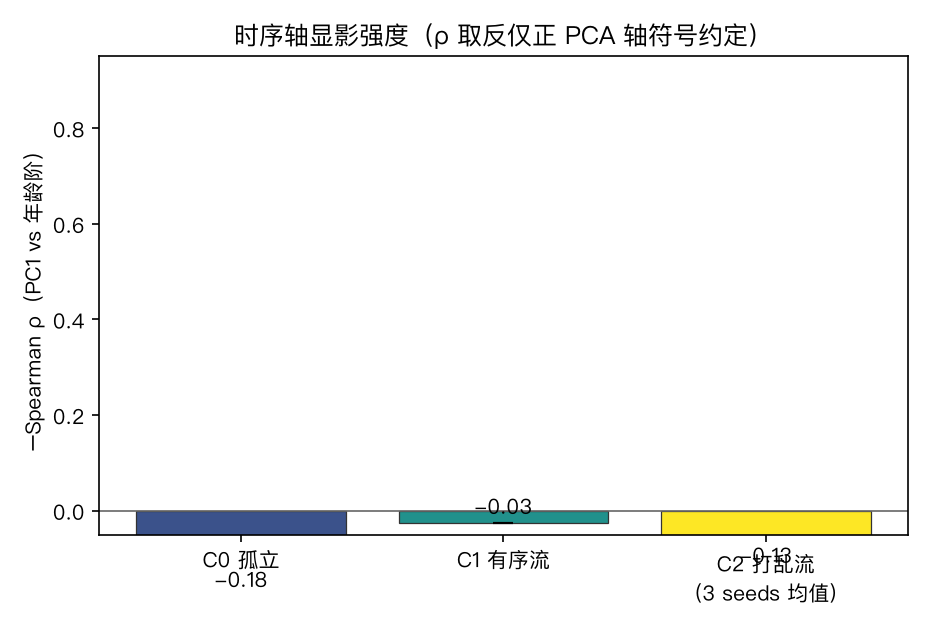
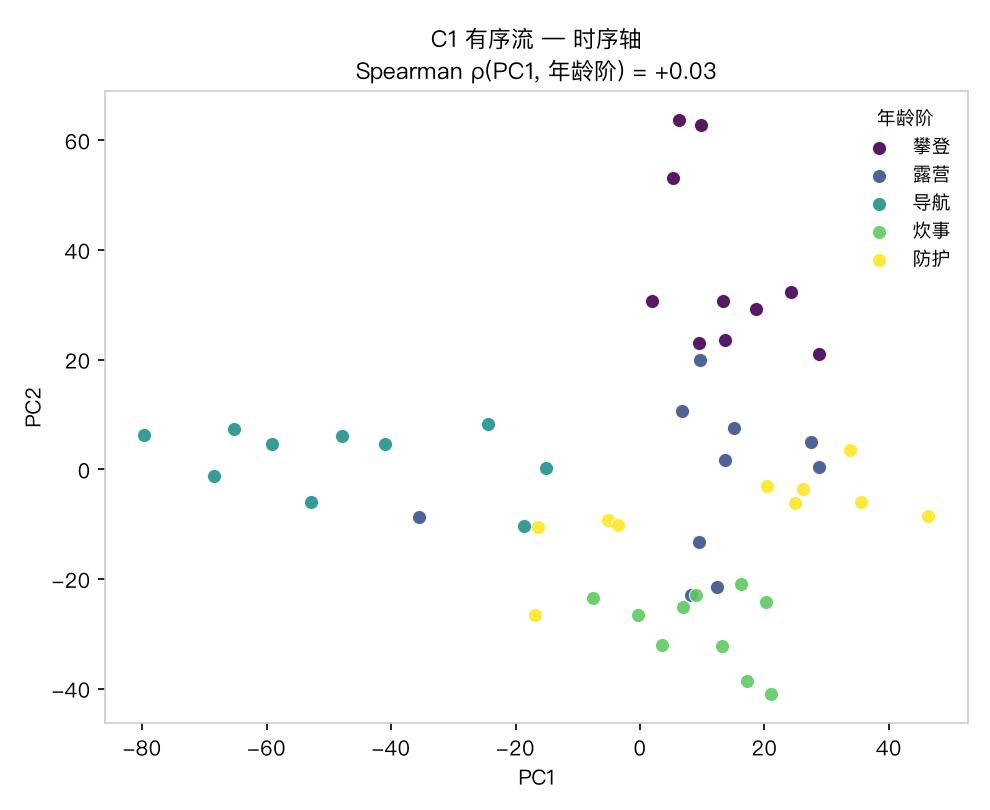
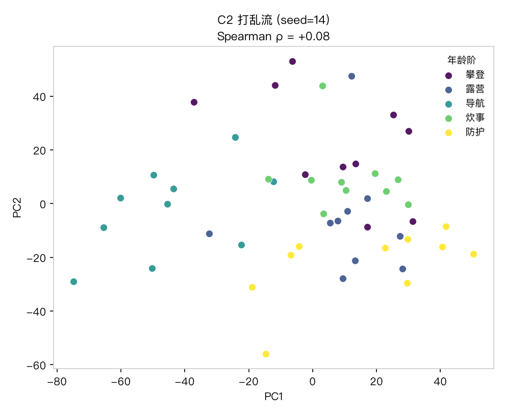
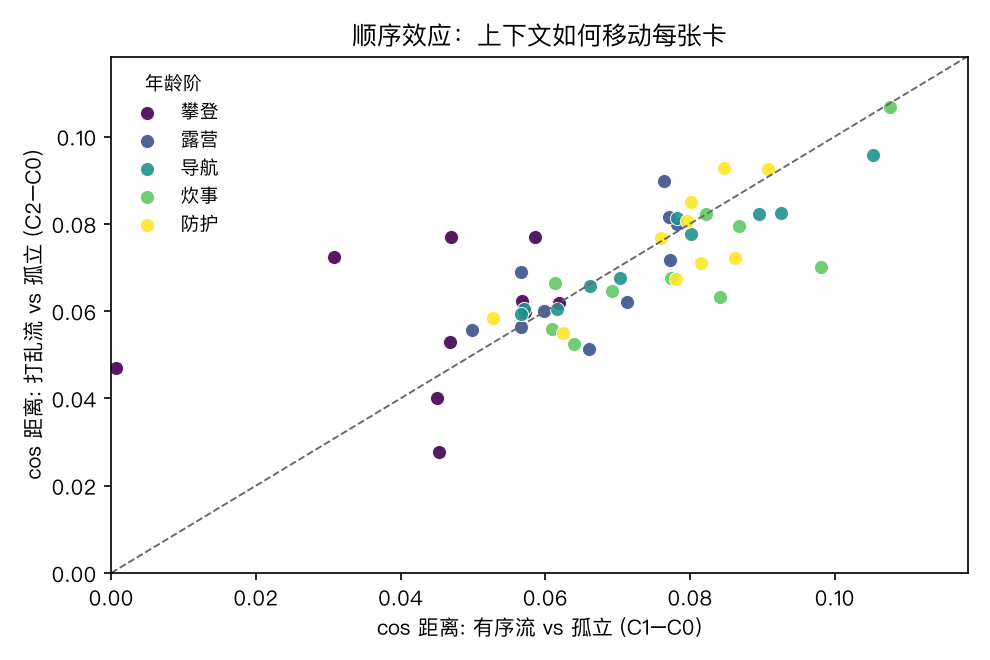
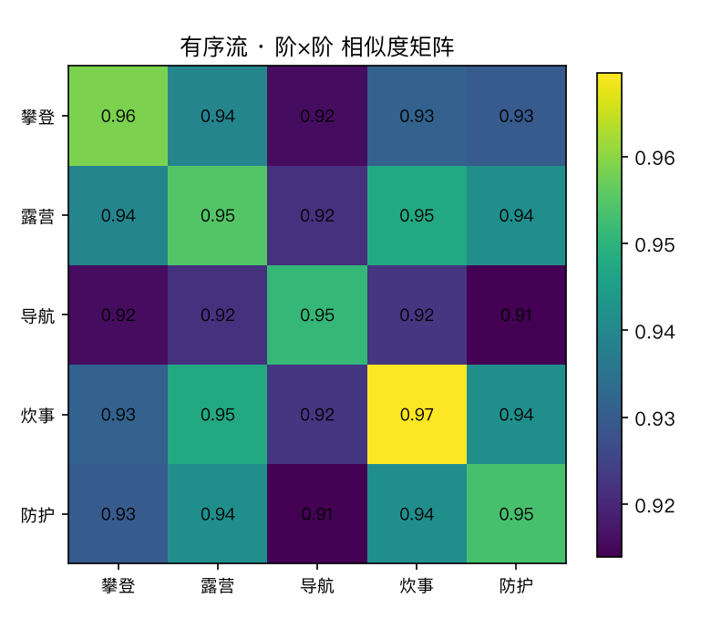
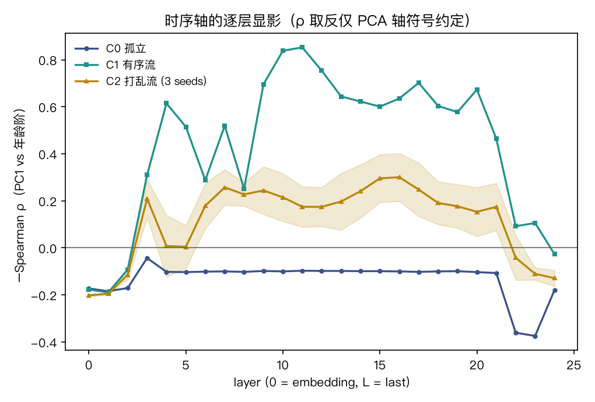

# 为什么要一个对照舱

婴幼儿商品实验（D5_baby）发现：**有序流把时序轴显影增强了 22%**（ρ: 0.62→0.76），
打乱即回基线。但这个读数有一个 rival hypothesis（竞争解释）：

> 会不会**随便**给语料排个序、再喂成流，PC1 就会显出一条轴来？

对照舱的设计就是把这条 rival hypothesis 逼到墙角：
登山装备按功能分 5 类（攀登/露营/导航/炊事/防护），**类别序号 1–5 是任意指定**——
模型的世界知识里不存在这条「时序轴」。若有序流在此舱也产生 ρ 增强，
则 baby 舱的结论垮掉；若不产生，则「有序增强」确为**真时序轴的特异性读数**。

语料：`corpus_mountain.json`，50 卡 × 5 类 × 各 10 卡，描述同样不含类别词。
方法、旋钮、三条件（C0 孤立 / C1 有序流 / C2 打乱×3 seeds）与 baby 舱全同（同一正本 `product_temporal.py`）。

# 读数

| 条件 | Spearman ρ（PC1 vs 类别序） | p 值 |
|---|---|---|
| C0 孤立 | +0.179 | 0.21（不显著） |
| C1 有序流 | +0.026 | 0.86 |
| C2 打乱流（3 seeds） | +0.129 ± 0.035 | — |











几何：阶内/阶间比 C0=1.015、C1=1.024——同样无簇结构（功能类之间相似度本来就高，商品语料通病）。
顺序效应：C1=0.069 / C2=0.069，逐阶单调（C1: 0.045→0.079）——与 baby 舱一样，
这是因果注意力的机械性质，与语料有没有时序结构无关。

# 逐层显影（射击 2）



对照舱的逐层曲线让证据更硬：

1. **中层（9–13）有序峰两舱同高**（本舱 +0.85 vs 时序舱 +0.87）：这是**流位置伪影**——有序流里「位置↔类别序」共线，模型在中层编码流中位置；本舱打乱流即消失（C2≈+0.20）。与时序结构无关。
2. **末层本舱三条件皆 ≈0**（C1=−0.03 / C2=−0.13 / C0=−0.18）：任意类别序在末层不产生任何轴——与时序舱末层 C1=+0.76 形成干净对照。
3. 结论加硬：时序舱的末层有序增强不是「有序流普遍效应」，而是**真时序轴**的显影。

# 判词

1. **对照舱如期失效**：任意类别序在任何条件下都不产生显著时序轴（p≥0.21），有序流甚至比打乱流还弱（0.026 vs 0.129）。
2. **特异性成立**（末层读数；中层有序峰为流位置伪影，两舱皆有，已剥离）——把两舱末层并排——
   | 舱 | 有序增强（\|C1\|−\|C2\|） | 孤立轴显著性 |
   |---|---|---|
   | D5_baby（时序） | **+0.143** | p=1.5e-06 |
   | D5_mountain（对照） | **−0.103** | p=0.21 |
   「有序增强」只在真时序轴上出现。rival hypothesis 被否。
3. 机械性质与结构性质要分开记账：顺序效应的逐阶单调（两舱皆有）是注意力机制的指纹；ρ 的有序增强（仅时序舱）才是时序结构的指纹。

# 诚实账

- 类别序虽任意，但 5 个功能类本身语义可分——模型可能按语义聚类，PC1 恰好与任意序号的相关性是运气项（ρ=+0.179 即此类噪声）；这正是打乱条件要吸收的，C2 基线已含此噪声。
- 单模型（0.5B）、单固定 seed——与 baby 舱同限。
- 登山装备的「时序」（季节/登山进程）确实弱；若要更严格的对照，可用**纯随机词表**（无语义类），但那样又失去「商品语料」的对称性——此为设计取舍，如实记。

# 复现

```bash
cd benches/transformer_vis
/opt/miniconda3/envs/default/bin/python product_temporal.py corpus_mountain.json   # → figs_D5_mountain/ + metrics_D5_mountain.json
quarto render report_D5_mountain.qmd --to html
```
