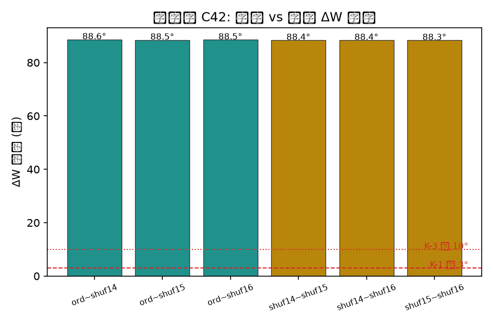
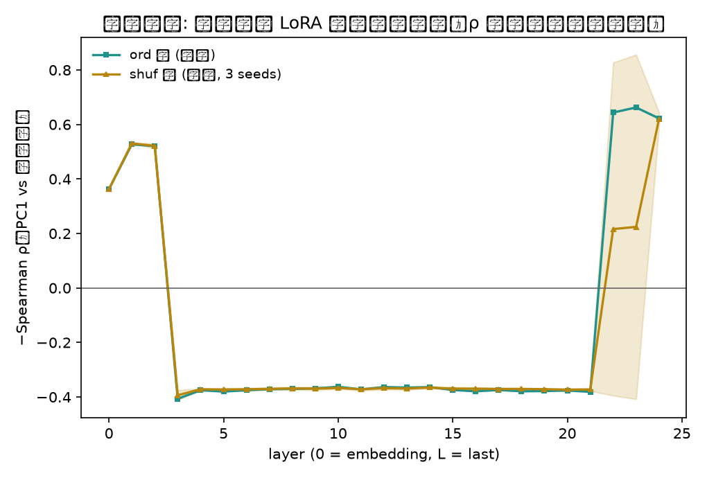
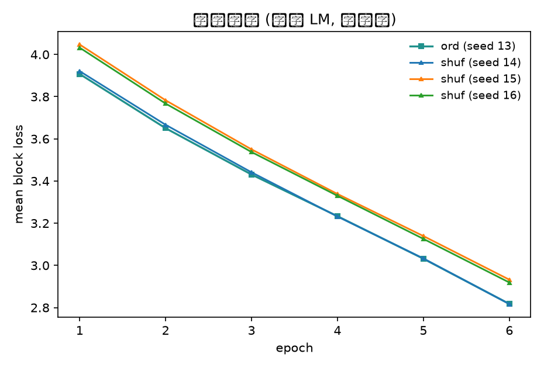

# 背景

编码级证据（`report_stage.html`）只证明「同一袋卡、不同喂序 ⇒ 表征不同」，
量级是末层 ρ 的 +0.14。dag06 正律的完整形态要求**训练级**证据：
有序语料与打乱语料各训一个 LoRA，两个适配器的权重增量（ΔW）是否不同？
若训练也非交换，则「序即结构」从表征层推进到**权重层**。

量法沿用 exp12c 园线（`chora/experiments/exp12c-curriculum/`）：
两两 ΔW 夹角（度），臂间夹角与 seed 散布对账。

# 园线与判据（先冻）

园线（exp12c）：**r=16 / α=32 / 6 ep / lr=1e-4 / Adam β2=0.95**
（β2 转写自 exp12c 记录 "b2a4"，如实标注）；
目标模块：注意力四矩阵 `q/k/v/o_proj`；任务：卡片流因果 LM；流切块 128 token 非重叠。

臂：

- **ord**：D5_baby 50 卡按年龄阶序（seed 13）
- **shuf ×3**：同 50 卡打乱（seeds 14/15/16）

判据（跑前登记）：

| 判 | 条件 | 解读 |
|---|---|---|
| K-1 | ord~shuf ΔW 夹角 < 3° | 时序课程序在 LoRA 尺度不可感 |
| K-2 | 3°–10° | 序效应真实但弱 |
| K-3 | > 10° | 强效应 |
| K-4 | 臂间夹角 ≤ shuf 间散布 | 一律归零 |
| K-5 | ord 臂训后探针末层 ρ ≥ shuf 臂均值 + 0.05 | 训练把时序轴刻进权重 |

# 读数







| 量 | ord~shuf | shuf~shuf 散布 |
|---|---|---|
| ΔW 夹角 | 88.61° / 88.47° / 88.53°（均值 **88.54°**） | 88.37° / 88.37° / 88.33°（均值 **88.36°**） |

- **训练曲线**：ord [3.907→2.817] vs shuf [3.921→2.817]——几乎重合。
- **训后探针**：ord 臂末层 ρ=+0.62，shuf 臂末层 ρ=+0.62，差 **−0.002**（K5 不过）；
  逐层峰值 ord 在层 23（+0.66）、shuf 在层 24（+0.62）——与基座 C0 读数（+0.62）相同。

# 判词

1. **实质裁决：K-4 归零**。臂间夹角（88.54°）与 seed 散布（88.36°）同量级，差 0.18°——
   时序课程序在 LoRA 权重尺度**不可辨**。
2. **判据实现教训（如实记）**：脚本字面裁决落到 K-3（>10° 强效应），但这是误判——
   LoRA 的 ΔW 因随机初始化天然近正交（~88.5° 是**所有臂对**的基线，shuf~shuf 亦然），
   绝对阈值在近正交基线下失效。exp12c 的 K-1（<3°）预设「无效课程 ⇒ ΔW 相似」，
   该预设对 LoRA 不成立；量法应改为「**臂间夹角 − 散布**」的差值检验。
3. **K5 不过**：6 ep 训练没有把时序轴刻进权重——训后时序轴强度与基座相同（ρ=0.62）。
4. 总结论：「序即结构」目前只在**编码级**成立（末层 +0.14，`report_stage.html`）；
   训练级（6 ep LoRA、50 卡小语料）不成立——序效应没有沉到权重。
   「归零」是「此预算下不可辨」，不是「序效应不存在」的证明。

# 诚实账

- 单模型（0.5B）、单 deck（D5_baby）、训练步数极少（每臂 6 ep × ~6 块）——过拟合风险高，读数是指示性的。
- β2=0.95 为转写值；若 exp12c 原值不同，角度量级会变，方向性结论应复核。
- ΔW 夹角对 LoRA 的 A/B 初始化对称性敏感——三臂同基座同分布初始化，臂间可比；实测 ~88.5° 基线说明**绝对夹角不可用**，应用相对对账（臂间 vs 散布）。
- 预算极小（6 ep × ~6 块 ≈ 36 步）：「归零」是「此预算下不可辨」，非存在性否定。改进方向：更多 epoch、更大语料、或改用「ΔW 在固定方向上的投影」而非夹角。

# 复现

```bash
cd benches/transformer_vis
/opt/miniconda3/envs/default/bin/python train_c42.py corpus_baby.json   # → figs_c42/ + metrics_c42.json
quarto render report_c42.qmd --to html
```
