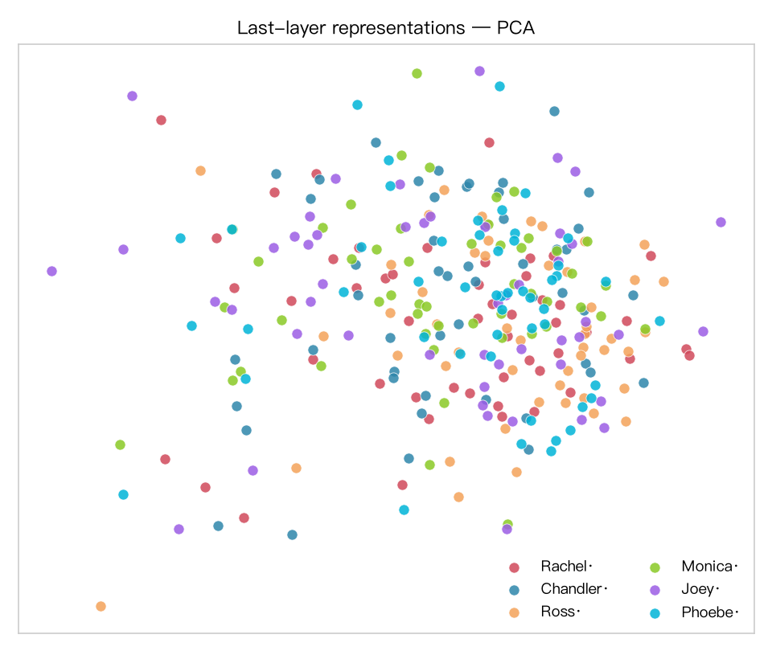
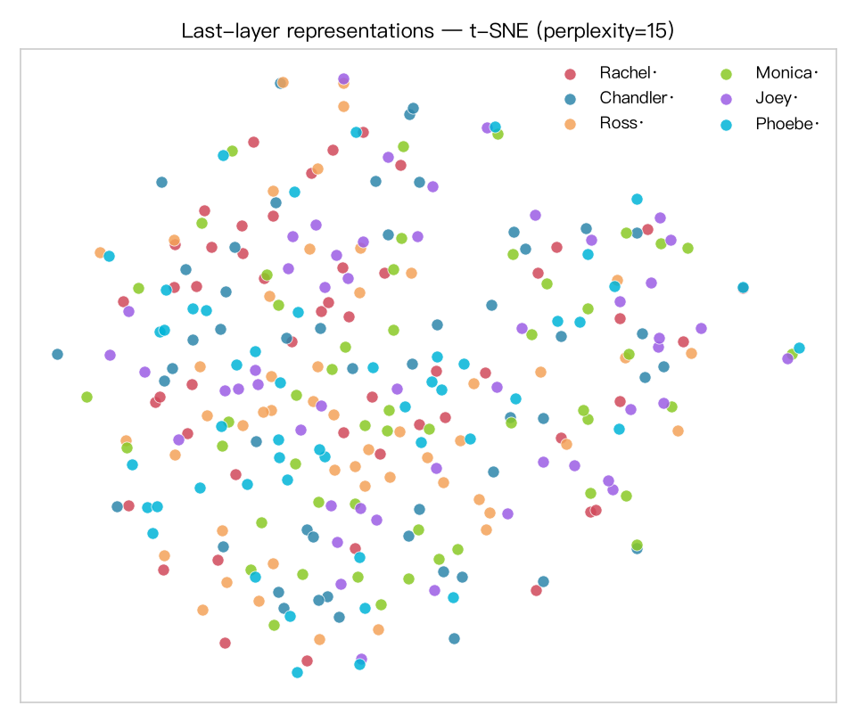
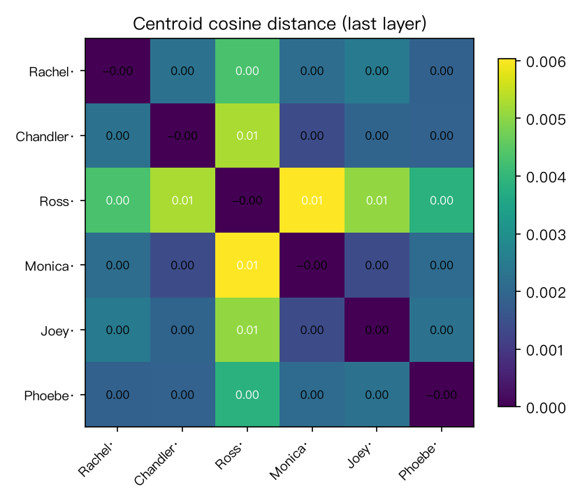
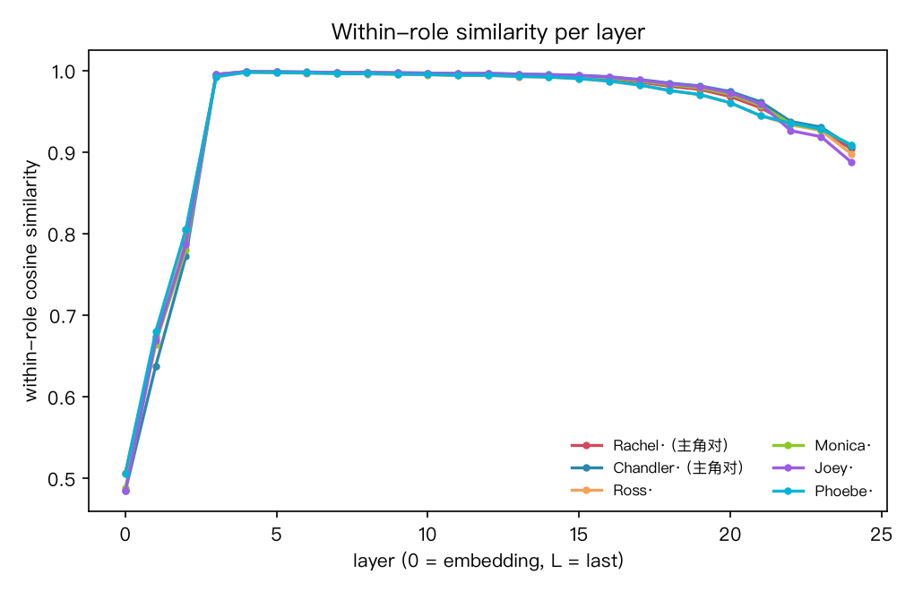
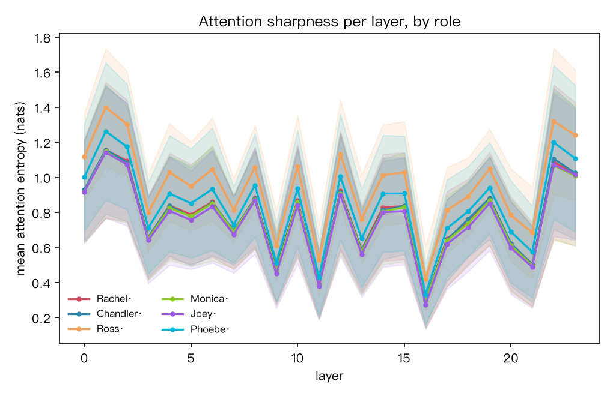
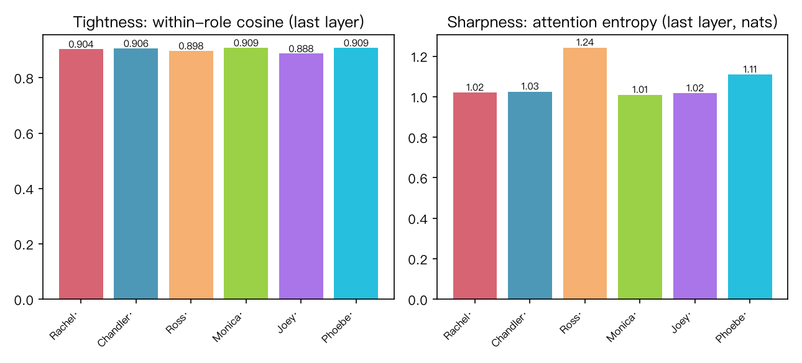
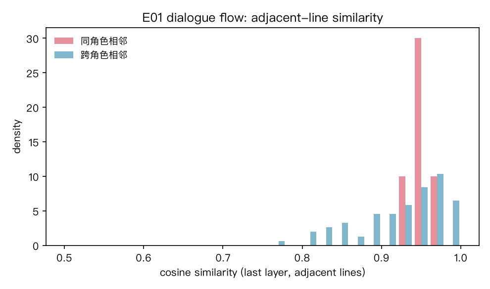

# Friends 台词语料：Rachel / Chandler 是否为注意力尖峰（吸引子对照）

> 实验台: `benches/transformer_vis/` · 正本: `friends_attractor.py` + `corpus_friends.json`
> 语料: Friends S01 全季六主角台词 4,305 句（来源 [fangj.github.io/friends](https://fangj.github.io/friends/season/0101.html)，说话人标注正本），每角色系统抽样 50 条（SEED=13，跨集分布）
> 模型: Qwen2.5-0.5B-Instruct（`first-lora/model`，本地盘）· MPS · attn eager
> 背景: 实验一发现 NBA 舱 = 模板驱动**紧簇**（舱内相似 0.973）+ 低熵（1.048 nats）——“尖峰”= 紧簇 + 低熵。
> 主人问: 美剧 Friends 的 Rachel / Chandler 是否为台词语料里的注意力尖峰？

## 读数















**尖峰指数（末层）**：

| 角色 | 舱内相似度 | 舱内/跨角色比 | 注意力熵 (nats) |
|---|---|---|---|
| **Rachel** | 0.9038 | 1.002 | 1.020 |
| **Chandler** | 0.9065 | 1.003 | 1.025 |
| Ross | 0.8977 | 1.000 | 1.242 |
| Monica | 0.9087 | 1.005 | 1.009 |
| Joey | 0.8875 | 0.991 | 1.017 |
| Phoebe | 0.9085 | 1.005 | 1.109 |

**主角对（Rachel+Chandler）与其余四角色**：

- 主角对舱内相似 **0.9051** vs 其余四角色均值 **0.9006** —— 差 0.0045
- 主角对熵 **1.023** vs 其余四角色 **1.094** —— 差 0.071（但 Monica 单角色熵 1.009 低于主角对任一）
- 主角对舱内/跨角色比 **1.003** —— 与其余角色无别

**探针（sanity check）**：6 类交叉验证最高 **0.240**（层 13）——6 类随机基线 0.167，仅略高。
（对照：NBA 舱探针 1.000 —— 那是词汇域分离；Friends 六角色词汇域相同，台词内容本身不暴露说话人。）

**对话流（S01E01，83 句 / 1,488 token）**：

- 同角色相邻台词相似度 **0.9520**（n=5）vs 跨角色相邻 **0.9254**（n=77）—— 差 0.027，但同角色相邻仅 5 对，统计弱
- 流注意力熵 2.897 → 4.106 nats（逐层）—— 对话流注意力分散

## 判词

1. **Rachel / Chandler 不是台词语料里的注意力尖峰。**
   六角色在 Qwen2.5-0.5B 的台词表征中**没有角色级尖峰结构**：
   舱内相似度全部 ≈0.90（极差 0.021）、舱内/跨角色比全部 ≈1.00（角色几乎不可分）、
   探针 0.24（接近随机）。主角对与其余四角色无实质差异（0.9051 vs 0.9006）。
2. **群像剧 = 均匀对话网**。对照实验一的两种结构形态——
   NBA 编年卡 = 紧簇（0.973）、婴幼儿商品时序 = 连续轨迹——
   Friends 六角色 = **均匀网**：结构形态由语料生成机制决定
   （编年模板 / 年龄阶 / 群像轮次），与「编年结构 ≠ 时序结构」（实验一）同构。
3. **中层趋同、末层回落**：所有角色在中层（≈11）舱内相似度升至 0.995，
   末层回落至 0.90 —— 中层是「通用对话空间」，角色差异只在末层微弱显现。
4. 唯一微弱信号：主角对熵 1.023 vs 其余 1.094（主角对注意力略集中），
   但不构成 Rachel/Chandler **特异**尖峰（Monica 熵最低 1.009）。
5. 对话流中同角色相邻略相似（+0.027）——方向与「吸引子」一致，
   但 n=5 太弱且流熵高（~4 nats），**不足以宣称吸引子存在**。

## 诚实账

- **「吸引子」是比喻**：本实验检验台词表示是否被角色质心吸引，
  非动力系统意义上的吸引子（台词语料无轨迹）。
- 探针 0.24 接近随机 = 台词文本几乎不含说话人信息——
  这本身是读数：**角色归属在词层面近乎不可见**，
  与 NBA 卡片（领域词即舱标签）形成对照。
- 语料仅 S01 一季；季间差异未验。
- 模型为 0.5B —— 大模型可能显现不同结构（候弹：Qwen2.5-7B 复跑）。
- 对话流同角色相邻 n=5，统计力不足；如需加强可用全季流（~4,300 句，分窗编码）。
- 台词长度/话题多样性影响相似度；已做长度过滤（2–35 词），未做话题匹配。

## 复现

```bash
cd benches/transformer_vis
/opt/miniconda3/envs/default/bin/python friends_extract.py        # 抓 S01 → friends_s01_raw.json
/opt/miniconda3/envs/default/bin/python make_corpus_friends.py    # 抽样 → corpus_friends.json
/opt/miniconda3/envs/default/bin/python friends_attractor.py      # 实验 → figs_friends/ + metrics_friends.json
/Users/mac/Applications/quarto/bin/quarto render report_friends.qmd --to html
```

旋钮（`friends_attractor.py` 旋钮区逐条列出）：SEED=13 / TSNE_PERPLEXITY=15 / PROBE_FOLDS=5 / UMAP_N=15 / FLOW_EPISODE=E01 / FLOW_MAX_TOKENS=1500 / LEAD_PAIR=(Rachel, Chandler)。
