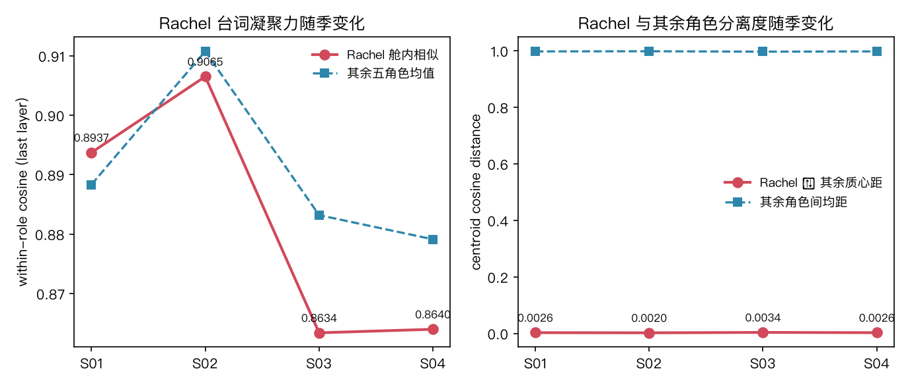
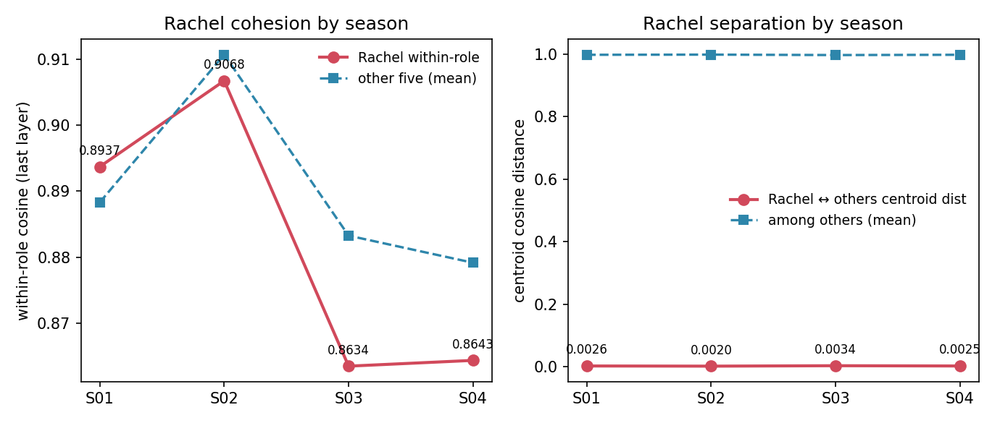
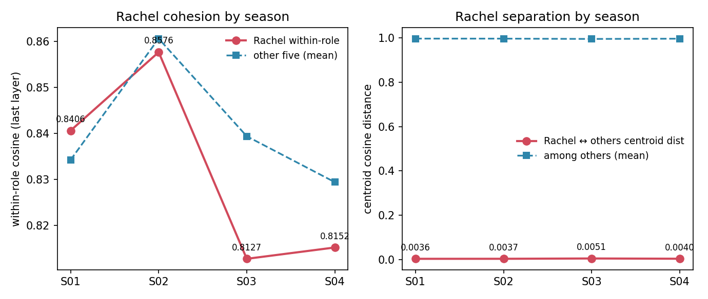
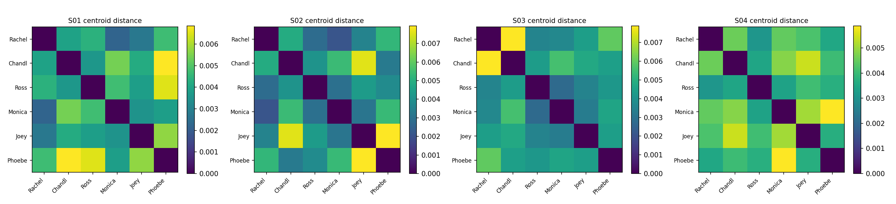
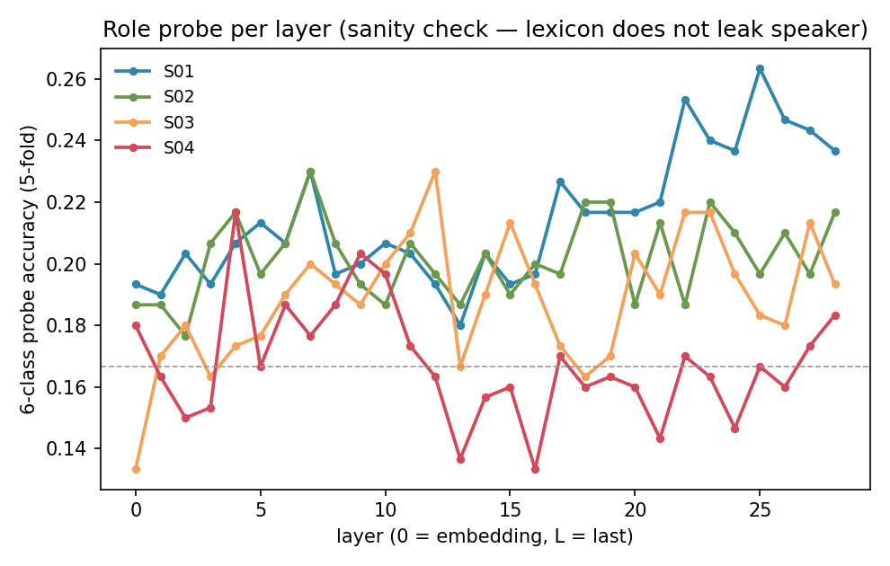
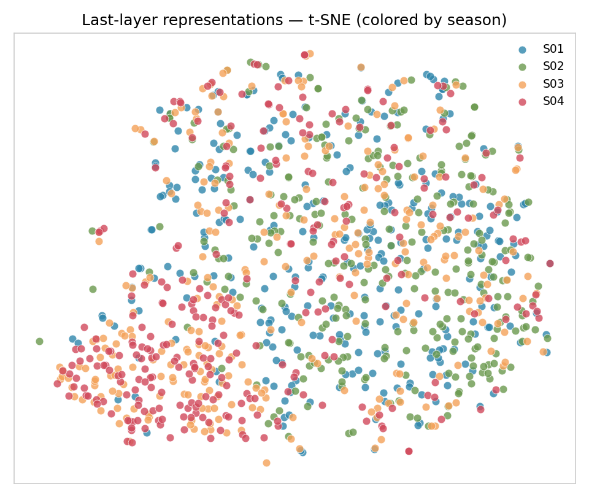
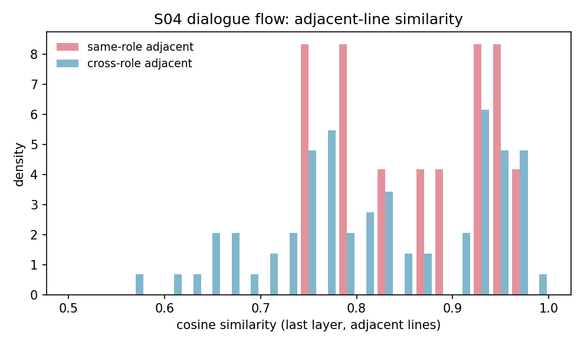

# Friends 季节演化（S01–S04 · 双平台夜航）：Rachel 的特色是否在 S03/S04 才凝聚？

> 实验台: `benches/transformer_vis/` · 夜航 PREREG: `kaggle/PREREG.md`（判据先冻）· 战报: `kaggle/战报-friends-seasonal-kaggle-2026-10-13.md`
> 正本声明（三样交付律）: **正本**＝`friends_seasonal.py` + `corpus_friends_s1234.json` + `friends_s1234_raw.json` + 本地 `metrics_friends_s1234.json`；**投影**＝Kaggle 两臂 `run.py`（`kaggle/make_arms.py` 由 `run_template.py` 生成，语料 gz+b64 内嵌，sha256 对正本解压字节逐位同源）；**verify**＝`python3 kaggle/verify_friends_kaggle.py <kaggle_metrics.json>`（退出码即判据）
> 语料: Friends **S01–S04** 六主角台词（来源 [fangj.github.io/friends](https://fangj.github.io/friends/season/0101.html)），每季每角色 50 条系统抽样，共 1,200 条（S02 已补齐——fangj 站该季为整集单块格式，解析器已兼容）
> 模型: 本地 Qwen2.5-**0.5B**（bf16-on-disk · MPS）∥ Kaggle **0.5B**（bf16，自检臂）∥ Kaggle **7B**（bnb-4bit, compute fp16, bnb 0.50.2）· attn eager
> 主人观感: 「到了第三季和第四季, Rachel 才表现出特色」
> 假设: H-S1 Rachel 舱内相似度 S03/S04 > S01 · H-S2 Rachel 质心距 S03/S04 > S01 · H-S3 对照（其余五角色随季同形 = 季间漂移，非 Rachel 特异）

## 读数

**Rachel 时间线（末层）· 三臂并置**：

| 季 | Rachel 舱内（本地 0.5B / Kaggle 0.5B / Kaggle 7B） | 其余五角色均值 | Rachel 质心距 | Rachel-vs-rest 探针 |
|---|---|---|---|---|
| S01 | 0.8937 / 0.8937 / **0.8406** | 0.8883 / 0.8883 / 0.8342 | 0.00257 / 0.00258 / 0.0036 | 0.757 / 0.760 / 0.793 |
| S02 | 0.9065 / 0.9068 / **0.8576** | 0.9108 / 0.9107 / 0.8606 | 0.00202 / 0.00202 / 0.0037 | 0.767 / 0.763 / 0.783 |
| S03 | 0.8634 / 0.8634 / **0.8127** | 0.8832 / 0.8833 / 0.8394 | 0.00341 / 0.00341 / **0.0051** | 0.777 / 0.773 / **0.813** |
| S04 | 0.8640 / 0.8643 / **0.8152** | 0.8791 / 0.8791 / 0.8294 | 0.00255 / 0.00255 / 0.0040 | 0.787 / 0.790 / 0.780 |

> 0.5B 两臂逐项对表全在冻结容差内（**K-1 通过**，见下）；7B 为 4bit，绝对值低一档属量化偏差，**只比形态不比绝对值**（K-4）。







**每季六角色舱内相似（末层）· 7B 臂**：

| 季 | Rachel | Chandler | Ross | Monica | Joey | Phoebe |
|---|---|---|---|---|---|---|
| S01 | 0.8406 | 0.8514 | 0.8139 | 0.8316 | 0.8372 | 0.8369 |
| S02 | 0.8576 | 0.8588 | 0.8675 | 0.8557 | 0.8585 | 0.8624 |
| S03 | **0.8127** | 0.8604 | 0.8296 | 0.8353 | 0.8563 | 0.8153 |
| S04 | **0.8152** | 0.8067 | 0.8215 | 0.8193 | 0.8454 | 0.8540 |

**对照 H-S3（Δ vs S01，7B 臂）**：

| 季 | ΔRachel 舱内 | Δ其余舱内 | 判定 |
|---|---|---|---|
| S02 | +0.0170 | +0.0263 | 同形 → 季间漂移 |
| S03 | **−0.0279** | +0.0051 | **异形 → Rachel 特异** |
| S04 | **−0.0254** | −0.0048 | 异形（降幅 5×）→ Rachel 特异 |

**探针**：Rachel-vs-rest 二类 7B 臂 S03 达峰 0.813（S01 0.793）；6 类探针 7B 0.217–0.263 / 本地 0.217–0.230，均近 6 类随机基线 0.167——台词词汇不暴露说话人。







**对话流（S04 开头，86 句 / 1,471 token；两臂计数逐位相同）**：

| 臂 | 同角色相邻 | 跨角色相邻 | 差 |
|---|---|---|---|
| 本地 / Kaggle 0.5B | 0.9129 / 0.9134（n=12） | 0.9081 / 0.9077（n=73） | 0.005 |
| Kaggle 7B（4bit） | 0.8669（n=12） | 0.8251（n=73） | **0.042** |



## 判词

1. **K-1 平台迁移成立**：Kaggle 0.5B 臂 45 项指标全在冻结容差内（余弦 max |Δ| 3.4e-4 / 探针 3.3e-3 / 流计数逐位相等）——本地 MPS 单点读数为真，跨平台可复现。
2. **主人的观感在词表征中未获支持——方向相反**（0.5B 与 7B 一致）：Rachel 舱内相似度 S03/S04 **下降**（7B：0.8406 → 0.8127 → 0.8152），H-S1 不成立；质心距 H-S2 只在 **S03** 成立（+42%），S04 回落——观感的「S03/S04」实为「S03 单季」。
3. **但 Rachel 确在 S03/S04 走成异类**（对照 H-S3 异形）：S03 其余角色舱内均值微升（+0.005）时 Rachel 独降（−0.028）。半只脚落地：**Rachel 的「特色」是真实的，只是形态为「更发散」而非「更凝聚」**——S03/S04 的 Rachel 台词彼此更不相似。
4. **7B 的对话流读出更强的同角色聚集**（相邻同角色 vs 跨角色差 0.042，0.5B 仅 0.005）：大容量下「谁在跟谁说话」的局部结构更清楚，但这是流结构，不改变时间线判词。
5. **人类观感 ≠ 词表征**：主人的「特色」感知来自叙事层（角色弧光、表演、情境），词层面表征不承载这些信息——这本身就是读数：**角色特色是叙事现象，不是词汇现象**。

## 夜航故障两连（均已解，留痕于战报）

- **Kaggle 源 1MB 上限**（首射 400）：语料内嵌改 gz+b64（2.84MB → 0.63MB），sha256 仍对正本解压字节。
- **bnb 缺失 + 断网**（二射 ImportError；三射 pip 解析失败）：7B 臂 metadata 单独开 internet 装 bnb 0.50.2（**偏离 PREREG 的 enable_internet=false，模板注记登记**）；bf16 退路未用。

## 诚实账

- 7B 为 bnb-4bit：与 bf16 的绝对偏差不可归零（K-4 不裁决）；本地无 7B bf16 基线，跨模型只比形态。
- 每季每角色 50 条系统抽样；台词长度/话题多样性影响相似度；流同角色相邻 n=12，统计力弱。
- 「特色」的操作化（舱内相似度 + 质心距）只是一种量化；人类感知的角色特色可能对应别的表征维度（情绪极性、句法复杂度、叙事位置）。
- 6 类探针近随机 = 台词词汇不暴露说话人（同 S01 实验纪律）。

## 复现

```bash
cd benches/transformer_vis
/opt/miniconda3/envs/default/bin/python friends_extract.py 1 2 3 4      # 抓 S01-S04
/opt/miniconda3/envs/default/bin/python make_corpus_friends.py 1 2 3 4  # 抽样 1200 条
/opt/miniconda3/envs/default/bin/python friends_seasonal.py              # 本地 0.5B 正本实验
python3 kaggle/make_arms.py                                            # 生成两臂 run.py（gz+b64 内嵌+对撞）
/opt/miniconda3/envs/default/bin/kaggle kernels push -p kaggle/friends-seasonal-0-5b   # 自检臂
/opt/miniconda3/envs/default/bin/kaggle kernels push -p kaggle/friends-seasonal-7b     # 7B 臂
python3 kaggle/verify_friends_kaggle.py kaggle/out-0-5b/metrics_friends_s1234_kaggle.json  # K-1（退出码即判据）
/Users/mac/Applications/quarto/bin/quarto render report_friends_s1234_kaggle.qmd --to html
```

旋钮（正本 `friends_seasonal.py` 旋钮区逐条列出）：SEED=13 / TSNE_PERPLEXITY=15 / PROBE_FOLDS=5 / FLOW_MAX_TOKENS=1500 / LEAD=Rachel。
