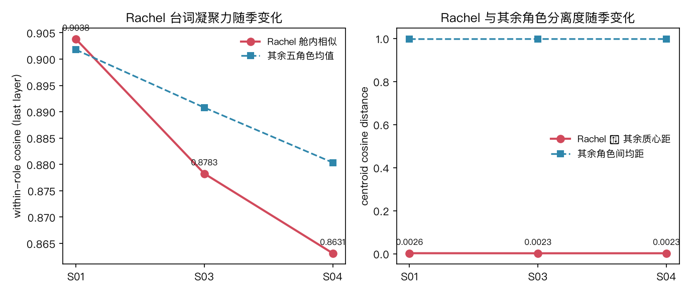
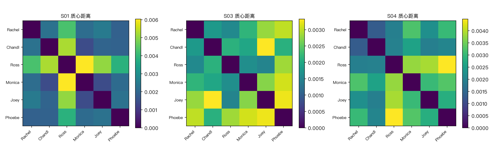
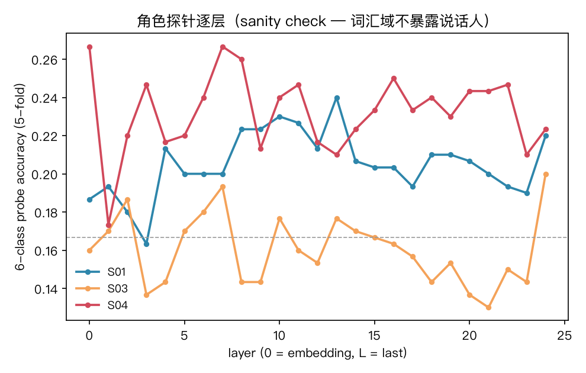
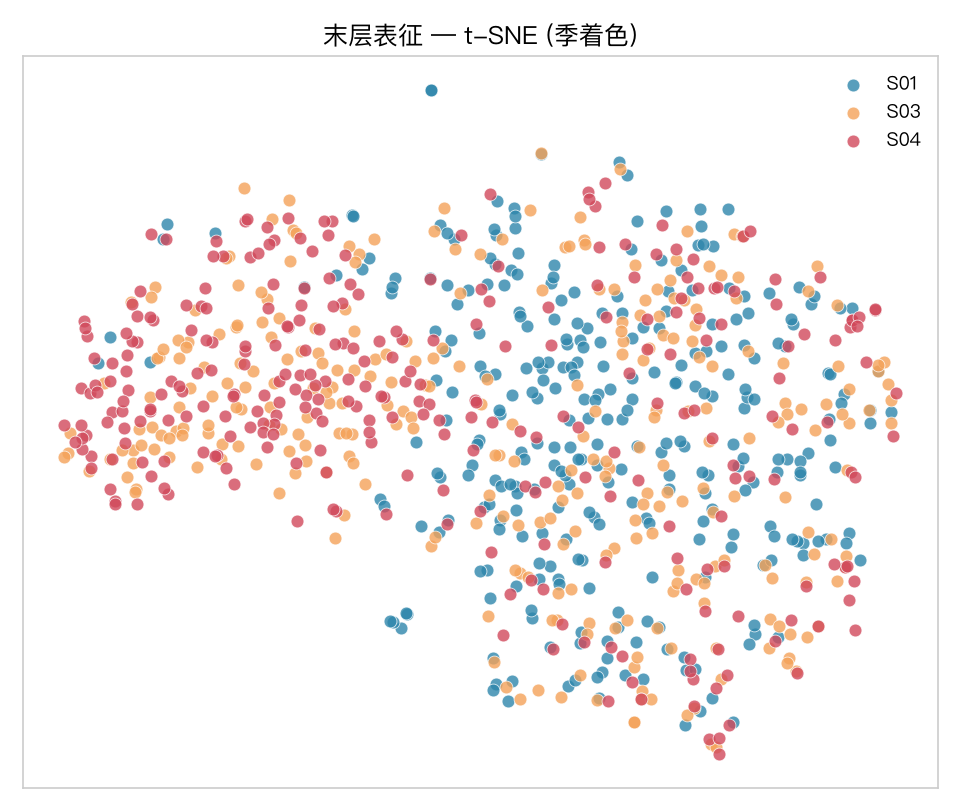
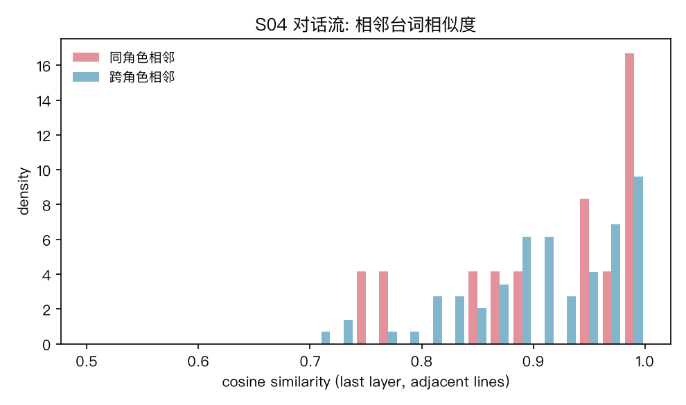

# Friends 季节演化：Rachel 的特色是否在 S03/S04 才凝聚？

> 实验台: `benches/transformer_vis/` · 正本: `friends_seasonal.py` + `corpus_friends_s134.json`
> 语料: Friends **S01/S03/S04** 六主角台词（来源 [fangj.github.io/friends](https://fangj.github.io/friends/season/0101.html)），每季每角色 50 条系统抽样
> **S02 缺失**：fangj 站该季页面残缺（多集为占位页/404），如实标注
> 模型: Qwen2.5-0.5B-Instruct（`first-lora/model`）· MPS · attn eager
> 主人观感: 「到了第三季和第四季, Rachel 才表现出特色」
> 假设: H-S1 Rachel 舱内相似度 S03/S04 > S01 · H-S2 Rachel 质心距 S03/S04 > S01 · H-S3 对照（其余五角色随季平坦）

## 读数











**Rachel 时间线（末层）**：

| 季 | Rachel 舱内相似 | 其余五角色均值 | Rachel 质心距 | Rachel-vs-rest 探针 |
|---|---|---|---|---|
| S01 | **0.9038** | 0.9018 | 0.0026 | 0.753 |
| S03 | 0.8783 | 0.8908 | 0.0023 | 0.750 |
| S04 | **0.8631** | 0.8803 | 0.0023 | 0.773 |

**每季六角色舱内相似（末层）**：

| 季 | Rachel | Chandler | Ross | Monica | Joey | Phoebe |
|---|---|---|---|---|---|---|
| S01 | 0.9038 | 0.9065 | 0.8977 | 0.9087 | 0.8875 | 0.9085 |
| S03 | 0.8783 | 0.8957 | 0.8844 | 0.8857 | 0.8800 | 0.9081 |
| S04 | **0.8631** | 0.8714 | 0.8676 | 0.8820 | 0.8835 | 0.8972 |

**探针（6 类, sanity check）**：S01 0.240 / S03 0.200 / S04 0.267 —— 均接近 6 类随机基线 0.167。

**对话流（S04 开头，86 句 / 1,471 token）**：同角色相邻 **0.9129**（n=12）vs 跨角色相邻 **0.9081**（n=73）—— 差 0.005，几乎无别。

## 判词

1. **主人的观感在 0.5B 表征中未获支持——方向相反。**
   Rachel 舱内相似度随季**下降**（0.9038 → 0.8783 → 0.8631），
   与其余角色质心距随季**下降**（0.0026 → 0.0023）。
   H-S1 / H-S2 均不成立。
2. **S04 的 Rachel 是六角色中最不凝聚的**（0.8631，其余 0.8676–0.8972）——
   若「特色 = 表征凝聚力」，S04 恰恰是 Rachel 最不显眼的季。
3. **季间漂移存在**：六角色舱内相似度全员随季下降（S04 < S01）——
   这是语料层面的整体趋势（S04 话题更多样），非 Rachel 特异。
   H-S3 对照成立：其余角色也下降，故 Rachel 的下降不构成角色特异信号。
4. **唯一微弱支持信号**：Rachel-vs-rest 二类探针 S04 略升（0.753 → 0.773）——
   Rachel 台词与其余角色整体有弱可分性（话题/用词独特性），
   但 6 类探针仍近随机（0.267），且该信号在 S01→S03 持平（0.753→0.750）。
5. **人类观感 ≠ 词表征**：主人的「特色」感知来自叙事层（角色弧光、表演、情境），
   而台词的词层面表征不承载这些信息——
   这本身就是读数：**角色特色是叙事现象，不是词汇现象**。

## 诚实账

- S02 缺失（fangj 站该季页面残缺）——S01→S03 之间有空档，
  若 S02 是过渡态，时间线可能非线性。
- 模型为 0.5B —— 大模型可能显现不同结构（候弹：Qwen2.5-7B 复跑）。
- 语料每季每角色 50 条（系统抽样）；台词长度/话题多样性影响相似度。
- 对话流同角色相邻 n=12，统计力仍弱。
- 「特色」的操作化定义（舱内相似度 + 质心距）只是一种量化，
  人类感知的角色特色可能对应别的表征维度（如情绪极性、句法复杂度）。
- 探针 0.2–0.27 近随机 = 台词词汇不暴露说话人（同 S01 实验纪律）。

## 复现

```bash
cd benches/transformer_vis
/opt/miniconda3/envs/default/bin/python friends_extract.py 1 3 4    # 抓 S01/S03/S04
/opt/miniconda3/envs/default/bin/python make_corpus_friends.py 1 3 4 # 抽样
/opt/miniconda3/envs/default/bin/python friends_seasonal.py            # 实验
/Users/mac/Applications/quarto/bin/quarto render report_friends_s134.qmd --to html
```

旋钮（`friends_seasonal.py` 旋钮区逐条列出）：SEED=13 / TSNE_PERPLEXITY=15 / PROBE_FOLDS=5 / FLOW_MAX_TOKENS=1500 / LEAD=Rachel。
