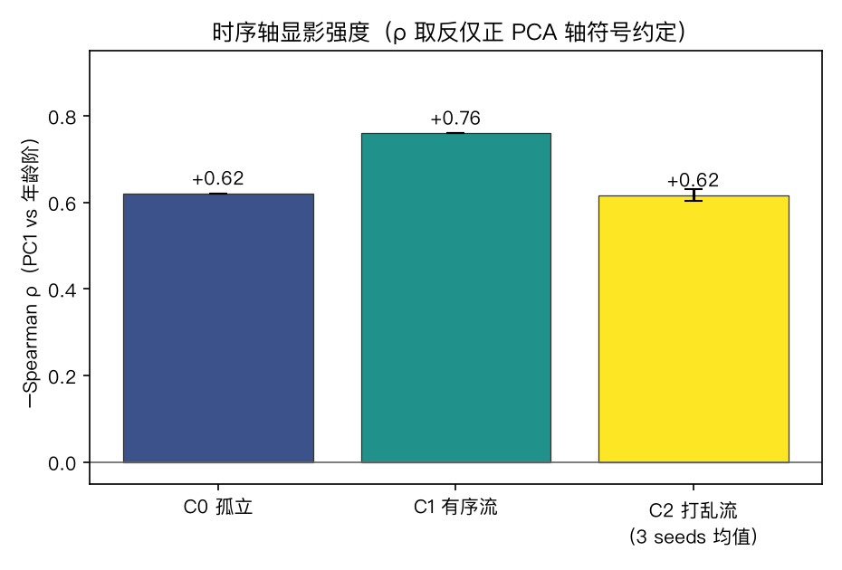
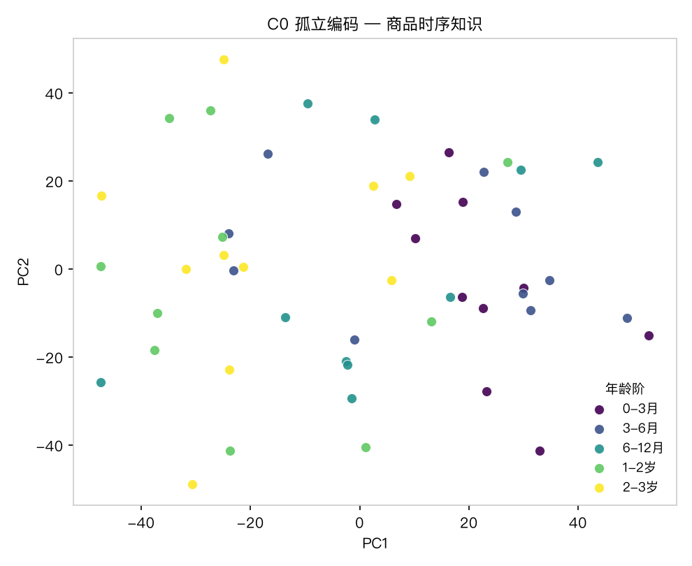
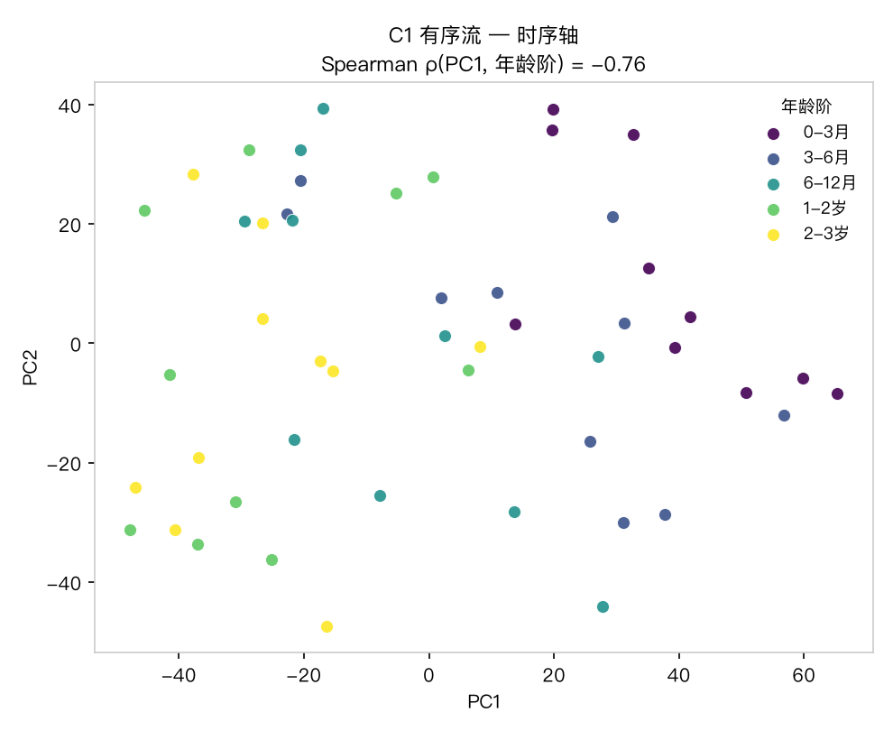
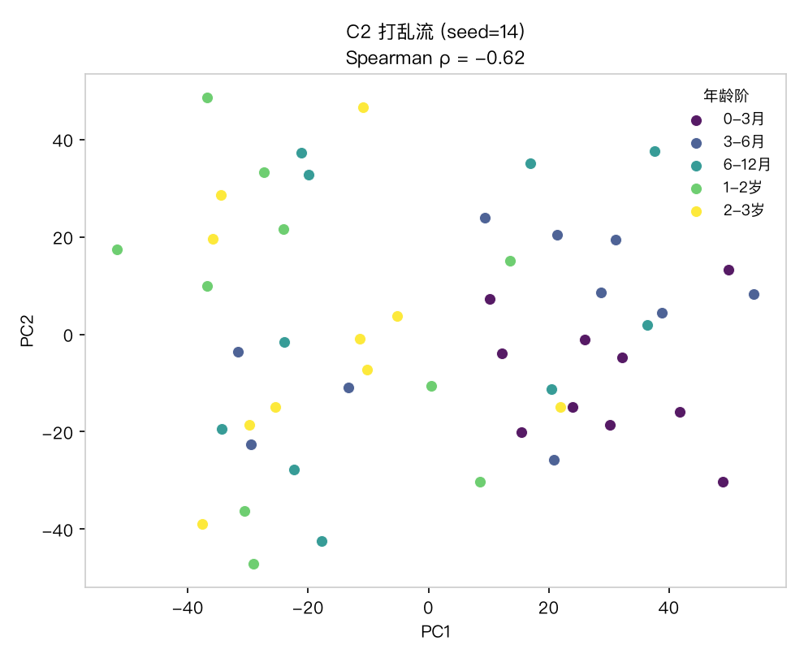
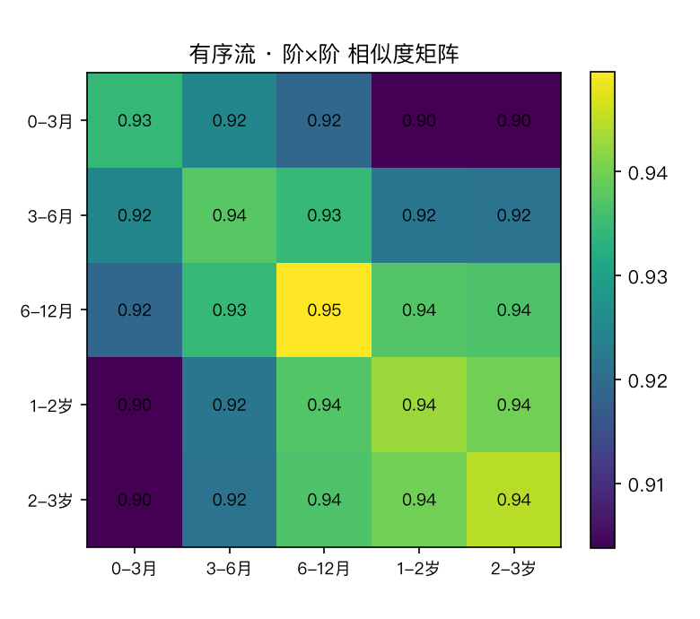
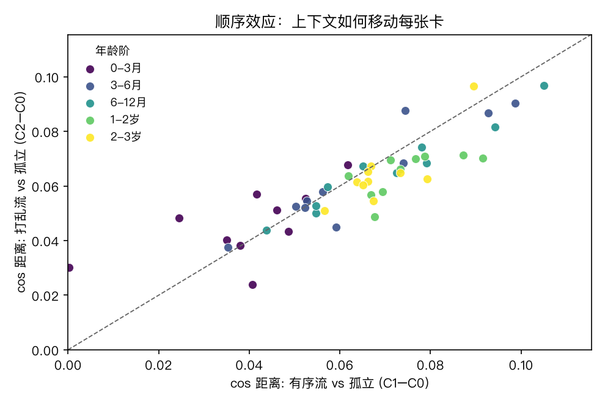
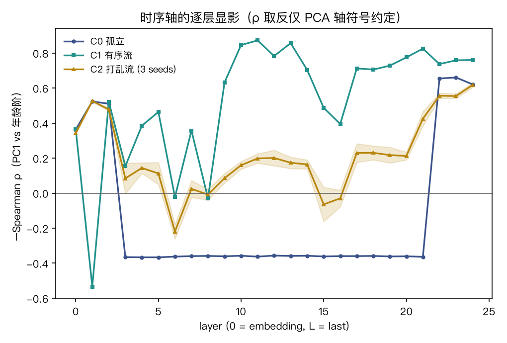

# 背景与问题

上一组实验（NBA × 春节）留下的候弹：**打乱对照**——把有序结构打乱，看 transformer 表征里的结构是否撕裂。本实验把它做实：

> 选一组**界限分明**的商品名作为语料（婴幼儿商品，50 卡 × 5 个年龄阶），
> 商品卡按年龄阶排成流编码；再打乱顺序重编码。
> 时序结构在表征里显影吗？打乱之后还在吗？

语料设计的关键一招：**商品描述里刻意不含年龄词**（没有「新生儿」「6月」字样）——
时序只能靠模型自己的世界知识读出（纸尿裤→奶瓶→学饮杯→平衡车 是一条真实的发育时间线）。
登山装备留作对照舱（其结构是功能/季节分类，时序轴弱——见候弹）。

# 方法

| 件 | 值 |
|---|---|
| 语料 | `corpus_baby.json`：D5_baby，50 卡，5 阶（0-3月 / 3-6月 / 6-12月 / 1-2岁 / 2-3岁）× 各 10 卡 |
| 模型 | Qwen2.5-0.5B-Instruct（`first-lora/model`，MPS，eager attention） |
| 三条件 | **C0 孤立**（逐卡单独编码，基线）· **C1 有序流**（50 卡按年龄阶拼流，因果上下文携带时序）· **C2 打乱流**（同 50 卡，3 个 shuffle seed = 14/15/16） |
| 切卡 | 流内按 tokenizer offset mapping 把 token 切回每张卡，mean-pool 末层 hidden states |
| 读数 | PC1 vs 年龄阶 Spearman ρ；阶内/阶间相似度比；顺序效应（流编码 vs 孤立编码的 cosine 距离） |

正本：`product_temporal.py`；派生：`figs_D5_baby/`、`metrics_D5_baby.json`、本报告。
复现（verify）：`/opt/miniconda3/envs/default/bin/python product_temporal.py corpus_baby.json` —— 退出码 0 且 `metrics_D5_baby.json` 重生成、与冻结账逐位一致即过（2026-10-13 已验）。

# 读数

## 时序轴的显影强度



| 条件 | Spearman ρ（PC1 vs 年龄阶） | p 值 |
|---|---|---|
| C0 孤立 | −0.621 | 1.5e-06 |
| **C1 有序流** | **−0.760** | 1.5e-10 |
| C2 打乱流（3 seeds） | −0.617 ± 0.013 | — |

（ρ 为负仅因 PCA 轴符号约定；读强度取绝对值。下同。）

## 三条件投影







三图合读：孤立编码下商品已沿 PC1 排成时序带（世界知识里的发育时间线）；
有序流中这条时序带被拉得更开；打乱流退回基线。

## 阶×阶相似度：轨迹，不是簇



| 条件 | 阶内相似度 | 阶间相似度 | 比值 |
|---|---|---|---|
| C0 孤立 | 0.929 | 0.926 | 1.004 |
| C1 有序流 | 0.935 | 0.924 | 1.012 |

阶内/阶间差异很小——商品时序结构**不是五个离散簇，而是一条连续轨迹**（相邻阶的相似度衰减平缓，矩阵无块状对角）。

## 顺序效应：因果注意力的累积



两种流都把每张卡从孤立位移动约 **0.06** cosine 距离（上下文效应与顺序无关）；
但**有序流中位移随阶次单调增大**（0.039 → 0.065 → 0.070 → 0.074 → 0.069），打乱流则平坦（≈0.064）——
因果注意力沿序列累积，越靠后的卡承载越多上下文。

## 逐层显影（射击 2）



逐层 ρ 曲线把两种现象分开——这一点对诚实记账至关重要：

1. **流位置伪影（中层 9–13，两舱皆有）**：有序流在两个舱的中层都把 PC1 对齐到「流中位置」（ρ≈+0.85）——因为有序流里位置与年龄阶完全共线；**打乱流即消失**（C2≈+0.18），对照舱（登山装备）也一样。这是位置编码的机械性质，**不是时序结构证据**。
2. **真时序轴（末层，仅时序舱）**：baby 舱末层 C1=+0.76 超过 C0/C2 基线（+0.62）——有序流让模型世界知识的时序轴在末层显影增强约 22%；对照舱末层三条件皆 ≈0。
3. 孤立编码（C0）中层是平的死区（无位置可编），早期层（0–2）已带弱时序信号（+0.36~+0.52）——时序知识在嵌入层已有胚。

所以「顺序即结构」的编码级证据严格说只是**末层那 +0.14**；中层的强峰是两舱共有的位置伪影，如实剥离。

# 判词

1. **时序知识在世界里**：孤立编码即有 ρ=−0.62（p≈1e-6）——0.5B 模型的世界知识里，婴幼儿商品自带一条发育时间线。
2. **顺序即结构（编码级证据）**：有序流把**末层**时序轴显影增强约 22%（0.62→0.76），打乱即回基线（0.617）。同一袋卡、不同顺序、表征不同——dag06 C42 非交换律在编码级成立。（中层强峰为流位置伪影，两舱皆有、C2 打乱即消失，已剥离，见上节。）
2b. **特异性已验**（对照舱 D5_mountain，登山装备 50 卡 × 5 功能类）：类别序为任意指定，孤立 ρ=+0.179 不显著（p=0.21），有序流 ρ=+0.026（p=0.86）**无增强**——「有序增强」不是「随便排个序」的普遍效应，而是真时序轴特有。见 `report_D5_mountain.html`。
3. **形态对照**：商品时序是**连续轨迹**（阶内/阶间比 1.012），NBA 编年是**紧簇**（舱内相似度 0.973）——「编年结构 ≠ 时序结构」：前者模板驱动、后者发育驱动。
4. **因果累积**：有序流中顺序效应随阶次单调增，是注意力沿序列读下去的直接指纹。

# 诚实账

- 语料小（50 卡）、单模型（0.5B）、单固定 seed（打乱条件 3 seeds）、PC1 单轴——读数是指示性的。
- ρ 的符号是 PCA 轴定向约定，强度看绝对值。
- 阶内/阶间比差异小（1.004→1.012）：结构信号主要由时序轴（ρ）承载，而非簇几何；别把「轨迹」读成「分簇」。
- 本模型盘曾用于春节舱 LoRA 案，对春节舱或有偏向；本实验不涉春节舱，但基座 vs 微调的公平性消融仍待做。
- 顺序效应量级小（≈0.06 cos 距离），统计稳健性待更大语料检验；其**逐阶单调**在两舱都出现，是因果注意力的机械性质，不作时序结构证据。
- 逐层读数暴露一个须记账的伪影：有序流在中层（9–13）产生的位置轴（两舱皆有、C2 打乱即消失）曾险些被误读为「顺序效应」——剥离后，顺序效应只剩末层 +0.14（时序舱特异，对照舱无）。

# 候弹（next shots）

- ~~**登山装备对照舱**~~（已射：`report_D5_mountain.html`，特异性成立）
- ~~**逐层 ρ 曲线**~~（已射：见上节；中层峰为流位置伪影）
- **训练级 C42**：有序 vs 打乱语料各训 LoRA，量三矩阵夹角——dag06 正律的完整形态（下一弹）。
- **更大模型**：Qwen2.5-7B 复跑，看世界知识的时序轴是否更清晰。

# 复现

```bash
cd benches/transformer_vis
/opt/miniconda3/envs/default/bin/python product_temporal.py corpus_baby.json   # → figs_D5_baby/ + metrics_D5_baby.json
quarto render report_stage.qmd --to html                       # → 本报告
```
